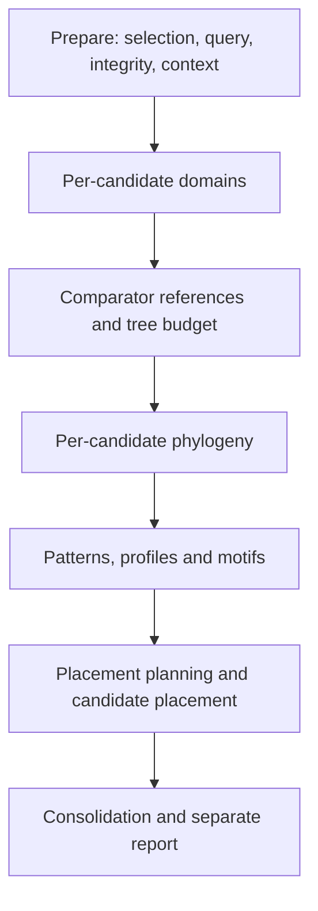

# AWARE to DeepSafe report: end-to-end audit

This walkthrough covers the AMRFinder review scope in v0.4.0a3. It describes
software behavior and the remaining native acceptance work; it is not a native
AFB01 analysis.

| Step | What happens | What must remain visible |
|---|---|---|
| 1. Saved screening | `Followup.smk` checks report/source hashes, sample identity, annotation checksums and completed setup. It has no screening or database-preparation rules. | Missing, changed or failed prerequisites stop the request; they cannot become negative findings. |
| 2. Explicit scope | `deep.enabled: true` requests follow-up; `deep.aware.scope: amrfinder-review` selects the new policy. Older saved configurations require an explicit scope overlay. | Effective configuration and source hashes are captured separately from screening. |
| 3. Review cues | Reported AMRFinder AMR HMM, partial and disrupted calls require investigation. Unsupported/conflicting method metadata goes to manual review. Other native calls remain for context review. | The review obligation exists even when follow-up is off or excluded. These cues do not recover unreported alignments. |
| 4. Identity and admission | AWARE applies source-specific admission and reconciles protein/locus identity. Multiple tools reporting the same verified locus share a candidate. Conflicting identity is held for review. | Every source remains linked. Other tools cannot admit unrelated candidates into this scope. |
| 5. Budget | Eligible candidates are ordered using the existing heuristic, then the default maximum of five is applied per isolate. | Deferred candidates retain their reasons; this is a computing ceiling, not a validated risk ranking or total runtime deadline. |
| 6. Query and routing | Extract the annotated protein, check sequence integrity, collect genomic context and select an available family profile. | Missing queries, taxonomic concerns and missing/ambiguous family configuration remain explicit. A linked exact call cannot bypass a selected investigation. |
| 7. Evidence layers | Run requested/eligible domain scans and comparator retrieval, then tree planning, phylogeny, PROSITE patterns/profiles, motifs and optional family placement. | Each layer has its own status and reason. Configuration, resources, family coverage and existing eligibility gates determine which analyses actually run. |
| 8. Consolidation | Combine exactly one result per selected candidate and retain all deferred candidates. Preserve source, query and reference provenance. | `completed`, `not_assessed`, `failed` and `deferred` are different states. Completed analyses do not establish function. |
| 9. Report | Render `safety/deepsafe-report/report.html`, full AMR-review TSV, evidence JSON and run summaries. Original screening stays separate. | Candidate review state and assessment limits remain separate from job completion. No automatic result records expert review closure. |

The execution order in step 7 is:

Domain evidence uses HMMER/Pfam; sequence comparator searches use the configured
BLASTP or DIAMOND path. Eligible trees use MAFFT and IQ-TREE. PROSITE, motif rules
and family placement have separate resource/enablement requirements. Presence of
a stage in the DAG does not mean a native analysis ran: an explicit abstention or
disabled stage still produces a state record. The five-candidate ceiling does not
bound the number of tool invocations per candidate. Current timeouts are per
command (default four hours), not a complete-run deadline.

## Regressions found and repaired during the audit

- The workflow renderer rejected a completed DeepSafe module containing a selected
  candidate with a terminal `not_assessed` result. It now renders that result only
  with an explicit reason and retains incomplete assessment scope. Failed,
  pending, running, unknown and missing selected-candidate states still cannot
  masquerade as a completed module.
- The new AMR-review TSV was not a requested Snakemake output. It is now both a
  declared report output and an explicit workflow target for screening and
  follow-up. Removing that export causes report regeneration from saved evidence
  without repeating DeepSafe analysis or changing screening inputs.

`test_nonempty_amr_review_through_saved_workflow_resume_and_report` uses the actual
`Followup.smk` entry point, candidate rules and renderer. Three synthetic source
findings become two unique candidates, one selected and one budget-deferred. It
stops after tree planning, resumes, checks every selected candidate stage, and
verifies unchanged screening checksums/timestamps and an unchanged no-op rerun.
Missing comparator resources remain `not_assessed`; a metadata-only synthetic
catalogue with no eligible comparators produces `completed` plus `unresolved`.
Both remain in the report and export. No native biological tool runs in this test.
Separate tests exercise failed-stage rejection and per-stage state integrity.

## Bactologix source transition

A follow-up request can use an explicitly selected installed BaSIS release when
Bactologix's official compatibility registry approves its follow-up entry point,
parent screening version and scope. General release discovery alone is insufficient.
The original screening source and outputs remain frozen. The new follow-up draft
records its own workflow commit, the parent's commit, both workflow checksums,
the selected scope and the reviewed release contract. Its runner/cache belong to
the selected installation, and native validation checks the saved screening bundle.

Choose the AMRFinder review scope explicitly for an older screening bundle.
A request that retains the original workflow also retains its original behavior.
DeepSafe remains opt-in, with a default ceiling of five unique candidates per
isolate; deferred or unassessed findings remain visible for review.

The follow-up report identifies the executing BaSIS version and retains the
screening version in its evidence metadata. Bactologix's run methods also record
the exact source transition. Completed software checks do not establish candidate
function or close outstanding review.

Before beta, verify the real AFB01/isolate1 candidate preview, resource coverage,
a nonempty native run, report/export consistency, restart and unchanged rerun.
See [AMRFinder review policy](AMR_REVIEW.md) and [acceptance gates](ACCEPTANCE.md).
